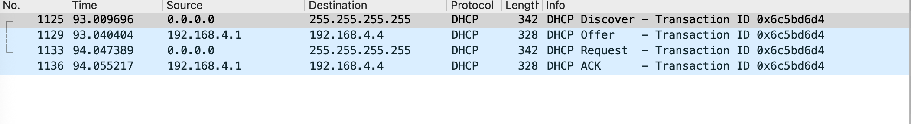

# Scenario 1: Laptop won't connect to Wi-Fi

Level: Basic
Note: Practice scenario. The details are fictional.

## Problem
A user's Windows laptop shows "No internet" and can't join the office Wi-Fi. Other people's devices work fine.

## Symptoms
- The Wi-Fi icon shows a warning or no networks at all
- Phones and other laptops connect to the same Wi-Fi without trouble

## Diagnostic steps
1. Check Wi-Fi is turned on. Look for airplane mode and the keyboard Wi-Fi key (often Fn + a function key).
2. Check if the laptop sees any networks. If none show up, suspect the adapter or driver. If networks show up but the office one is missing, suspect distance or the router.
3. Run `ipconfig`. An address starting with 169.254 means the laptop did not get an address from the router.
4. Open Device Manager and look under Network adapters for a yellow warning sign.
5. Forget the Wi-Fi network and reconnect with the password.

## Root cause
The Wi-Fi driver was out of date after a Windows update, so the adapter stopped working properly.

## Solution
1. Download the correct driver from the laptop maker's website on another device and copy it over on a USB stick
2. Install it and restart the laptop
3. Reconnect to the Wi-Fi and run `ipconfig` to check for a normal address
4. Ask the user to open a website to confirm

## Prevention
- Keep drivers updated, especially after big Windows updates
- Keep a copy of the main network drivers for common laptop models

## What I learned
Check whether other devices work first. It shows whether the problem is the laptop or the network.

## Practice in my lab
When a laptop gets no good address, I check how it asks for one. In my Wireshark lab I captured a normal DHCP request on my own network. A device gets its address in 4 steps: Discover, Offer, Request, ACK. If the laptop never gets the Offer, the problem is the network or the router. If the laptop gets an address and still has no internet, I look at the gateway and DNS.

More in my lab: [Lab 3: See the traffic](https://github.com/sreza0134-dev/network-labs/tree/main/lab-03-see-the-traffic)
