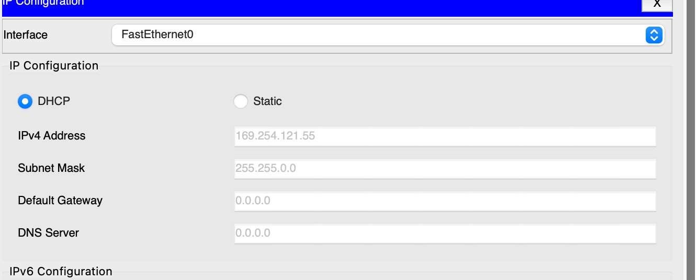

# Scenario 2: No internet and a 169.254 address

Level: Basic
Note: Practice scenario. The details are fictional.

## Problem
A user is connected to the office network by cable but has no internet. Nothing loads.

## Symptoms
- The network icon shows "No internet" or "Unidentified network"
- `ipconfig` shows an address starting with 169.254

## Diagnostic steps
1. Run `ipconfig`. The address is 169.254.x.x. This means the laptop asked for an address and got no answer from the router (DHCP).
2. Check the cable at both ends. Look for a loose plug or damaged cable.
3. Try a different cable and a different wall port.
4. Check whether other devices on the same switch get addresses. They don't, so the problem is wider than this one laptop.
5. Check the router or switch. The DHCP service had stopped after a power cut.

## Root cause
The router's DHCP service stopped after a short power cut, so no device could get an address. The laptop gave itself a 169.254 address, which only works locally.

## Solution
1. Restart the router (or the DHCP service on it)
2. On the laptop run `ipconfig /release`, then `ipconfig /renew`
3. Check that the address is now normal (for example 192.168.1.x) and that websites load
4. Ask other affected users to reconnect

## Prevention
- Put the router and key switches on a small battery backup (UPS)
- Check that DHCP starts automatically after a restart

## What I learned
A 169.254 address means the laptop asked for an address and got no reply. The next place to look is the router.

## Practice in my lab
I made this problem in Packet Tracer to see it for myself. My lab network has no DHCP server. When I set a PC to get its address by DHCP, it could not get one and gave itself an address starting with 169.254 and a mask of 255.255.0.0. There is no gateway and no DNS, so nothing outside the local network works.

This means the PC asked for an address and got no answer. I check the cable or Wi-Fi, then the DHCP server, then the DHCP pool on the router. In my Lab 2 I fixed a similar problem on a DHCP pool: [Lab 2: Fix the broken network](https://github.com/sreza0134-dev/network-labs/tree/main/lab-02-fix-the-broken-network)
