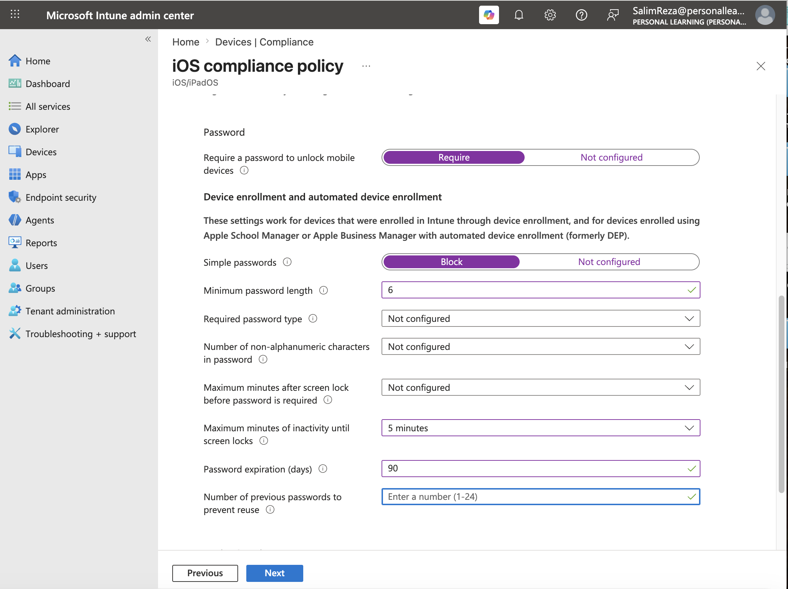
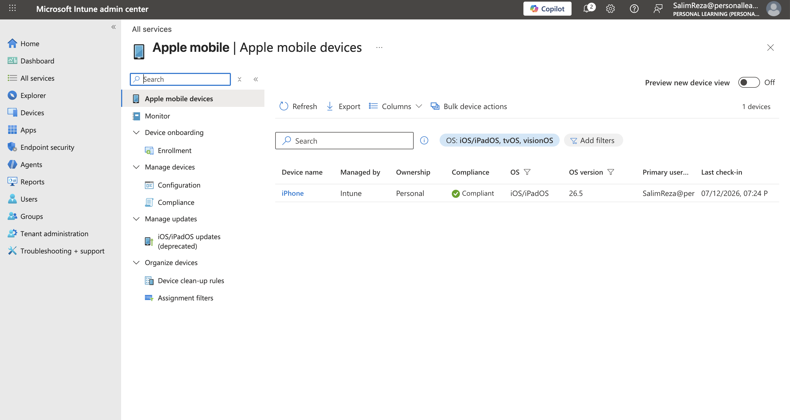

# Scenario 8: Phone blocked as "not compliant"

Level: Harder
Note: Practice scenario based on my Microsoft 365 lab. The details are fictional.

## Problem
A user can no longer open work email on their iPhone. The message says the device is not compliant. It worked yesterday.

## Environment
- iPhone enrolled in Microsoft Intune
- Compliance policy requires: minimum iOS 16.0, a passcode, no simple passcodes, passcode of at least 6 characters, screen lock after 5 minutes
- A Conditional Access policy requires a compliant device for email access

## Symptoms
- Email on the phone is blocked
- Company Portal shows the device as not compliant
- The user can still sign in from their laptop

## Diagnostic steps
1. Find the device in the Intune admin center under Devices. The compliance column shows "Not compliant".
2. Open the device and check the compliance status for each setting. It shows which setting failed.
3. The failed setting is the passcode. The user removed their phone passcode last night.
4. Check the last check-in time. The phone checked in this morning, so the status is current.
5. Check the Entra ID sign-in logs. They confirm the sign-in was blocked because the device is not compliant, so the block came from the policy and not from the account.

## Root cause
The user turned off the phone passcode. The device no longer met the compliance policy, so Conditional Access blocked access to company email.

## Solution
1. Ask the user to set a passcode that follows the policy (6 or more characters, not simple)
2. Open the Company Portal app and check the device status so it syncs now
3. Wait a few minutes, then refresh the device in Intune and confirm it shows "Compliant"
4. Ask the user to open email and confirm access is back

## Prevention
- The noncompliance email tells users early what to fix. Use clear wording in it.
- Tell users about the requirements (passcode, minimum iOS) when they enroll.
- Check the per-setting status first. It shows the cause straight away.

## What I learned
The device status in Intune shows which setting failed. Checking it first is faster than guessing.

## Practice in my lab
In my Intune lab I made a compliance policy for an iPhone. The policy has rules the device must follow. When a device does not follow them, Intune marks it as not compliant. After I set up the policy, the device showed as compliant. Looking at the policy settings is the first thing I check when a user says their device is not compliant.

More in my lab: [Microsoft 365 and Entra ID lab](https://github.com/sreza0134-dev/m365-entra-lab)
